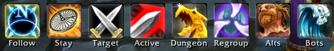
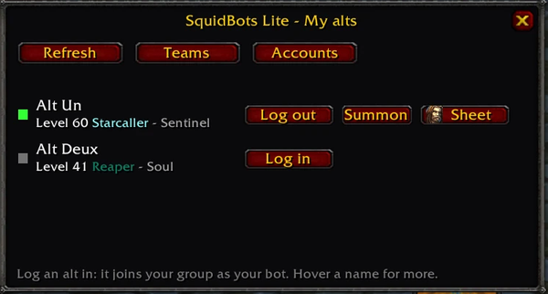
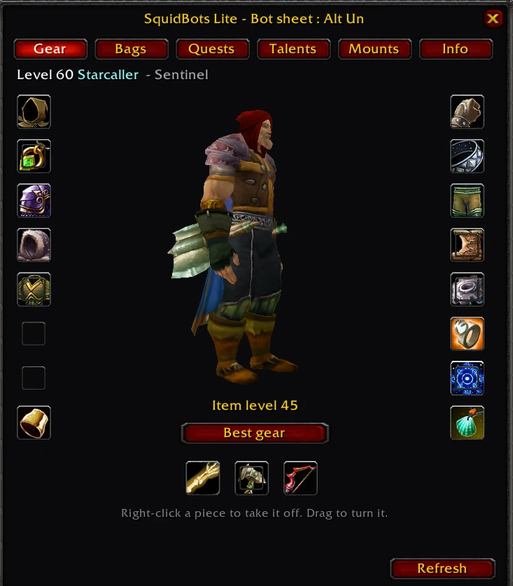
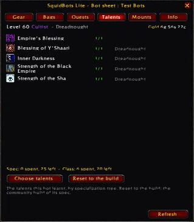
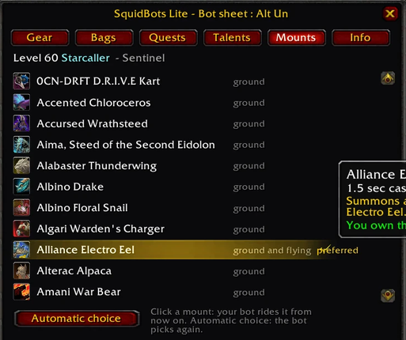

# SquidBots Lite

A World of Warcraft 3.3.5 addon for [CoA Bots](https://github.com/Zyth45/mod-playerbots): your bots, without a window in the way.

A thin bar of buttons, the bots' roles drawn straight onto the party frames you already have, and offers arriving as small toasts. And for those who play their own alts as bots: **My alts** and a **bot sheet** for every one of them (gear in 3D, bags, quests, talents, favourite mount).



## The bar

The **Alts** button opens [My alts](#my-alts); **Bots** asks for bots. Seven orders, one click each: **Follow**, **Stay**, **Attack my target**, **Active / Passive**, **Auto pull / No pull**, **Dungeon**, **Regroup**. Dungeon mode keeps bots with you, out of the stuff on the ground, and pulling when you pull. Regroup teleports every bot next to you, for the one stuck behind a wall.

The Active / Passive button shows where the bots stand: a charge arrow and *Active* while they fight, **Zzz** and *Passive* while they hold back. Passive also stops the tank pulling on its own; any order wakes them all.

The **Auto pull** button chooses whether the tank pulls on its own (arrow, *Auto pull*) or waits for you (shield, *No pull*): then it only fights what you or the group attack.

When a bot dies, a **Release** button shows up at the end of the bar: dead bots release their spirit and run back to their body.

Right-click the bar for profiles: **Farm** (hunt, loot, eat), **Strict follow**, **Dungeon**, plus two submenus:

- **Orders by role**: tank attacks my target, damage attacks my target, healers follow me or stay here, melee back to me, holding fire until the next order.
- **Formation**: close, line, circle, shield around me, arrow, single file.

Shift-drag a button to move the bar.

## Key bindings

Follow, Stay, Attack, Passive, Dungeon, Regroup and Release can each get a key: Esc > Key Bindings > SquidBots Lite. The keys work with the bar hidden.

## Asking for bots

The **Bots** button asks for a **tank**, a **healer**, **damage**, or all three. It types `lfg bot` in your Zone or Newcomers channel, exactly as you would. Free bots answer with an offer, shown as a toast above the bar with an **Invite** button.

The same menu builds a **raid of 10 or 25 bots** in one click (`.playerbots coa raid`, CoA Bots 1.7 or later): tanks, healers and damage dealers, every bot with its role in the raid panel. Players can build one every 30 minutes, up to 5 raids of bots at a time on the realm; the server answers in chat.

GMs can switch to `.playerbots coa` with `/sbl gm` and skip the channel. GM mode also adds **Regear level 60+ bots** to the menu.

## My alts

The **Alts** button on the bar (or **Bots > My alts**, or `/sbl alts`) lists the other characters of your account, logged-in ones first, each with its level, class, specialization and an XP bar; hover a name for its gold and XP. **Log in** brings one online as a bot of yours, and it joins your group; **Summon** brings it next to you, since it logs in where it logged out; **Sheet** opens its bot sheet; **Log out** sends it home. The list comes from `.playerbots bot list`, and the buttons type `.playerbots bot add` / `remove`, as you could yourself.

- **Teams**: save your group, or the logged-in alts, under a name, then log the whole team in or out in one click (one a second; a sixth member turns the party into a raid).
- **Accounts**: link another account with its security key (`.playerbots account setKey` on that account, then Link an account here) and log all its characters in as bots.

With `CoA.CollectionsForBots = 1` on the server, alts keep their look: wardrobe, outfits, vanity and mounts.



## Bot sheet

Opened from **Sheet** in My alts, a bot's role icon menu, or `/sbl bot <name>`:



- **Gear**: the bot in 3D (drag to turn it), every piece with its tooltip, the average item level, Best gear; right-click a piece to take it off.
- **Bags**: click an item for Give it to me (a trade opens with it), Equip, Use, Sell, Put in the bank; drop an item from your bags on the sheet to give it; Sell grey items; the **Bank** view when the bot stands by a banker. Trading with one of your bots opens its sheet on its bags (`/sbl sheettrade off` to stop).
- **Quests**: its quest log with tooltips; right-click a quest to abandon it.
- **Talents**: the talents and paid abilities it learnt, points spent and left; for your alts, **Choose talents** adds ranks with + and -, follows the prerequisites, and learns them on **Save**. Random bots keep their community build (Reset to the build).
- **Mounts**: every mount it knows; click one to make it its favourite, ground or flying.
- **Info**: its stats, and Follow, Stay, Summon, Open trade, Log out.

 

Mounts and talents need CoA Bots 2.1 on the server. Everything goes through chat commands a player can send to their own bots (`c`, `t`, `e`, `ue`, `bank`, `quests all`, `drop`, `talents ?`, `talents options`, `talents learn`, `mount ?`, `mount <spell>`); `/sbl sheetdebug` shows them and the answers.

## On your party frames

Each bot gets a role icon on its frame. Click it for that bot alone: come to me, stay here, attack my target, stats, best gear, remove from group. A tank adds auto pull on or off; a healer adds **Heal only me** (for a duo) and **Heal the whole group**.

A bot you invited by hand, not through `lfg bot`, is asked `co ?` once to learn its role; the question and its answer stay out of your chat. Only members known as bots are asked (a bot answer, the "Bot" surname, an alt of yours), never a real player; `/sbl roles off` turns it off. The frames also show **Low mana**, **Pulling** and **Rez** without a word of chat.

## Version check

At login the server names its CoA Bots version. SquidBots Lite carries the same number: when the server is ahead, the addon says in chat that a new version is out.

## Commands

```
/sbl                 show or hide the bar
/sbl show | hide     show or hide it, said outright
/sbl scale <0.5-2>   bar size (1 = normal; /sbl scale alone says the current one)
/sbl lang fr | en    French or English
/sbl channel <name>  ask in a different channel (a name, not a number)
/sbl alts            your other characters, played as bots
/sbl bot <name>      the bot sheet of a bot of your group (or of your target)
/sbl roles on | off  ask bots of unknown role for it
/sbl gm              GM mode
/sbl reset           put the bar back in the middle
```

Ctrl + mouse wheel over the bar also resizes it. The bar's size, place and shown/hidden state are kept per character; the language, channel and other choices stay account-wide.

## Install

It ships with CoA Bots, whose installer copies it into your client. To install it by hand, copy the `SquidBotsLite` folder into `Interface/AddOns`.

Everything it sends is a chat command mod-playerbots already understands: it never asks the server for anything a player could not type.

## Changes

**2.8**
- **Dungeon clear** on realms with mod-dungeon-clear: the bar's **Dungeon** button (or `/sbl dc`) opens its panel: the run's state and why it waits, On / Off / Pause / Skip, the pull mode (Dynamic, Leeroy, Advanced) and the dungeon's bosses with their state and a **Go** button, through the player's own `.dc` commands. A line under the bar shows what the tank is doing, and its messages show in the chat. Where the module is off, the panel says so; without the module, Dungeon keeps its dungeon mode, which also stays in the panel and in the bar's right-click menu.

**2.6.1**
- Wildcard realms: the lfg bot offers of Heroes ("DPS Hero Level 1 ... ready to go!") show their offer window again.
- Role icons stay off nameplates: no more "SetFrameStrata(): Unknown frame strata" error with enemy or friendly
  nameplates shown.

**2.6**
- Warcraft Reborn realms: bots of the WotLK classes (Warrior to Druid) count as bots. Their **Specialization** menu and the Specializations panel show the three classic trees of their class (English or French names) and switch them with `wcr spec 0|1|2`; the current tree is asked with `wcr`, both kept out of the chat. Role icons, Balance the group and the lfg bot offers (class and tree named in the offer) work for them too. CoA realms are unchanged.
- In a raid, bots outside your own subgroup are recognised too: no more "talents spec list" answers flooding the chat, and **My alts** no longer lists the raid's random bots.
- Role icons no longer land on nameplates: they go on the frames of the group alone. This ends the `SetFrameStrata(): Unknown frame strata: UNKNOWN` error on interfaces whose nameplates carry a health bar of their own.

**2.5**
- Ascension's raid-style party frames get the role icons, the bot menu and the alerts too (`/sbl raidframes off` to stop).
- Role icons cut cleanly from Ascension's role texture (no more edge of the next icon).
- **Bots > Take my quests**: every bot next to the quest giver takes your quests, alts included (`accept *`).
- A bot joining from the dungeon finder or a loading screen gets its role icon too (its late answer used to show in
  your chat and leave a "?"); an unknown role is asked again after 30 seconds.

**2.4**
- Ask for all three: up to 8 offers above the bar, and when there are too many, a damage offer goes first, so the tanks and healers stay (the tanks used to vanish).

**2.3**
- New **Auto pull** button on the bar: the tank pulls on its own, or waits (No pull, shield icon) and only fights what you or the group attack (`@tank nc +coa auto pull` / `@tank nc -coa auto pull`). The choice comes back after Passive, and a tank joining later gets it too. A key binding toggles it.

**2.2**
- A bot's menu: **Give me the lead** (the bot leads) or **Make it the leader** (you lead); a tank can **mark its target** with a skull (`rti skull`, `co +mark rti`).
- **Learn from my target (trainer)**: the whole group, or one bot, learns all a class or profession trainer teaches it (`trainer learn`).
- **Gathering**: skill-ups only (CoA Bots 2.2 default) or everything, for the whole group (Bots > Gathering) or one bot (`nc +gather all` / `nc -gather all`).
- Characters of linked accounts stay in My alts once logged in from here.
- Thanks to Maky for the ideas.

**2.1**
- **Alts** button on the bar; My alts shows each alt's level, class, specialization and XP, logged-in alts first, and scrolls for a raid of alts.
- **Teams** of alts (log a saved group in or out at once) and linked **Accounts**.
- **Bot sheet**: gear with the bot in 3D and its item level, bags and bank (give, equip, use, sell, drag and drop), quests (abandon), talents (see them, and choose your alts' talents rank by rank, prerequisites followed), favourite mount, stats.
- Menus close a second after the mouse leaves them.
- Thanks to Maky for the ideas.

**2.0**
- Same number as CoA Bots 2.0: a 1.9.x addon on a 2.0 server says a new version is out.
- Bar size: `/sbl scale 0.5` to `2`, or Ctrl + mouse wheel over the bar (issue #1).
- `/sbl show` and `/sbl hide`, beside `/sbl` which still switches.
- Size, place and shown/hidden are now saved per character (`SquidBotsLiteCharDB`); each character starts from the account-wide place of 1.9.

**1.9.2**
- Automatic roles ask only members known as bots: real players of the group no longer get the `co ?` whisper (PTR report).
- The addon says in chat when the server's CoA Bots is newer than itself.

**1.9.1**
- Fixed: the party frame's own role icon no longer peeks out under SquidBots' role icon (#5439).

**1.9**
- **Specialization** submenu in each bot's menu: Tank, Healer or Damage in one click, or pick a specialization from its list.
- **Bots > Specializations** (`/sbl spec`, or a key binding): the whole group at a glance, and **Balance the group** (one tank, one healer, your own role counted, everyone else damage).
- A bot gets back the specialization it last played in a role, and the bar's state after a switch.
- Panels with a plain dark background.

**1.8** (from now on, the same number as CoA Bots)
- **My alts** panel (Bots menu, `/sbl alts`): log your other characters in or out as bots, and summon them.

**1.6**
- Bots menu: **Raid of 10 bots** and **Raid of 25 bots** (needs CoA Bots 1.7 on the server).
- GM mode: **Regear level 60+ bots**.
- Offers from `lfg bot` now last 2 minutes instead of 5.

**1.5.2**
- Fixed: a Lua error when a bot lay dead out of range or on a flight path ("bad argument #2 to 'insert'").

**1.5.1**
- Fixed: role badges for bots whose name holds a space ("Name Bot", the default since CoA Bots 1.5).

**1.5**
- Regroup button (`summon`): every bot teleports next to you.
- Release button, shown only while a bot lies dead.
- Right-click menu: orders by role (`@tank`, `@dps`, `@heal`, `@melee`) and formations.
- Bot menu: stats and best gear for every bot; *Heal only me* and *Heal the whole group* for healers.
- Roles of bots invited by hand, learnt quietly with `co ?` (`/sbl roles off` to stop).
- Key bindings for the seven orders.
- The Active / Passive button shows the bots' state, and Passive stops the tank's auto pull: a passive tank used to pull a pack, then stand there.
- Fixed: any order now wakes passive bots (Attack was ignored), and the Dungeon button follows the profiles menu.

**1.4**
- First public release.

## Related

- [mod-playerbots, CoA Bots branch](https://github.com/Zyth45/mod-playerbots)
- [SquidBots dashboard](https://github.com/Zyth45/squidbots-dashboard)

## License

GPL-2.0, see [LICENSE](LICENSE).
